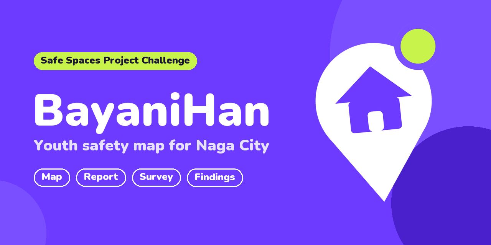

<p align="center">
  
</p>

# BayaniHan

**A youth-led safety map for Naga City's 27 barangays.** Young people anonymously mark public spaces that feel unsafe (dark streets, abandoned lots, harassment hotspots, unsafe routes, flooding) so barangays and the City can act on real evidence.

Built by Project BayaniHan, Camarines Sur National High School, for the Global Peace Foundation Philippines **Safe Spaces Project Challenge** (Safe Communities pillar).

> BayaniHan is not an emergency service. If you are in danger, call **911**.

## Features

| | |
|---|---|
| **Safety map** | Reviewed reports on a live map, filterable by type and barangay, with a "you are here" locator. |
| **Anonymous reporting** | A 7-step form: concern type, severity, time of day, who is affected, description and map pin. The barangay fills in from the pin. No names, ever. |
| **Youth survey** | A 2-minute anonymous survey on how safe young people feel and what would help. |
| **Findings** | Live charts by concern type, barangay, affected group and youth requests. Tap a barangay to see its snapshot. |
| **Ask BayaniHan** | A referral chatbot that points to the right hotline or office. Crisis messages (self-harm, danger) are always answered first with 911 and the NCMH 1553 crisis line. |
| **Safer route** | Compares real walking routes against reported concerns nearby. |
| **Coordinator tools** | Moderation with undo, an AI-assisted summary that stays a draft until a person checks it, a costed policy builder, ordinances and a referral directory. |
| **Bilingual** | English and Filipino. |

Also included: first-launch onboarding, haptic feedback, motion that respects the phone's *reduce motion* setting, and an offline notice when the map can't load.

## Privacy and safety by design

- **Anonymous by default.** The app never asks for a name, number, email, school or address.
- **Human review.** Every report stays pending until a youth coordinator approves it. Only approved reports appear publicly.
- **AI is a helper, not a decider.** Generated summaries and policy drafts are labelled as drafts until a reviewer checks them.
- Aligned with **RA 11313** (Safe Spaces Act), **RA 10627** (Anti-Bullying Act) and **RA 10173** (Data Privacy Act).

## Run it

Requirements: [Node.js](https://nodejs.org) 20+ and the **Expo Go** app on your phone.

```bash
git clone https://github.com/venstqs/BayaniHan.git
cd BayaniHan
npm install
npx expo start
```

Scan the QR code with Expo Go (Android) or the Camera app (iOS).

> The included `.npmrc` sets `legacy-peer-deps`, because a web-only dependency of Expo Router asks for `react-dom`, which this mobile app doesn't use.

### Build an installable app

Builds run in the cloud with [EAS](https://docs.expo.dev/eas/):

```bash
npx eas-cli@latest login
npx eas-cli@latest build --platform android --profile preview   # shareable .apk
npx eas-cli@latest build --platform android --profile production # Play Store .aab
```

### Checks

```bash
npx tsc --noEmit   # typecheck
npx expo-doctor    # dependency and config health
```

## Tech stack

[Expo](https://expo.dev) SDK 58 · React Native 0.88 · Expo Router · TypeScript · Leaflet maps with OpenStreetMap / CARTO tiles · walking routes from the FOSSGIS OSRM server · AsyncStorage · expo-location · expo-haptics

## Project structure

```
src/
  app/              screens (Expo Router: each file is a route)
    (tabs)/         Map, Report, Survey, Findings, More
    welcome.tsx     first-launch onboarding
    chat.tsx        Ask BayaniHan referral bot
    route.tsx       Safer route
    admin.tsx       coordinator review
  components/       shared UI, map, motion, admin panels
  lib/              data, store, analysis, theme, i18n, geo
assets/             app icons, splash, branding/
```

## Before a public launch

This build is a working pilot. To run it for real:

1. **Connect a backend.** Reports and surveys are currently saved only on the phone that made them (`src/lib/store.tsx`). Coordinators need a shared database such as Supabase or Firebase to see everyone's reports.
2. **Replace the demo PIN** on the coordinator screen with individual coordinator accounts.
3. **Verify local hotlines.** Numbers marked "to be confirmed" in `src/lib/data.ts` must be confirmed with CSWDO, PNP WCPD and the City.
4. **Check the local ordinance reference** (Naga City Ordinance No. 2023-107) against the official text.

## Brand

| | |
|---|---|
|  | **Mark:** a map pin with a house inside, for *bayanihan* (neighbours carrying a house together) and safe places on the map, plus a lime accent dot. |
| Colors | Violet `#6C3BFF` · Coral `#FF5A5F` · Lime `#C8F34A` · Ink `#1A1530` · Lavender `#F7F5FF` |
| Type | [Nunito](https://fonts.google.com/specimen/Nunito) Black / ExtraBold / SemiBold |

Logo files are in [`assets/branding/`](assets/branding/).

## License

[MIT](LICENSE) © Project BayaniHan
